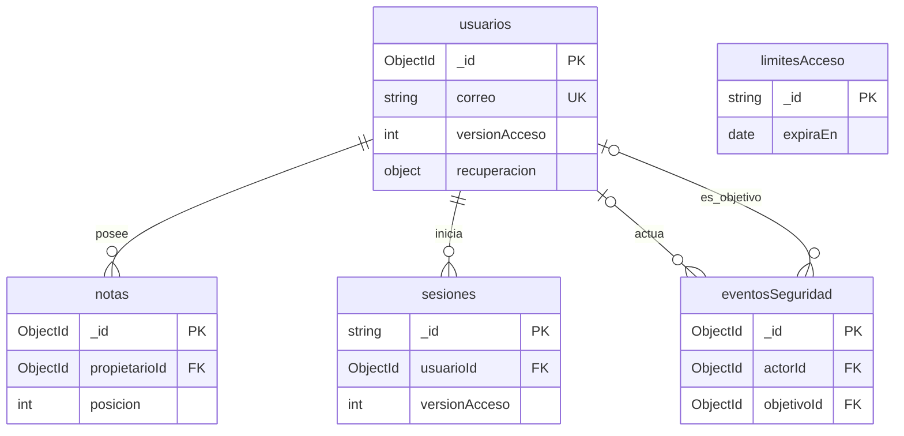
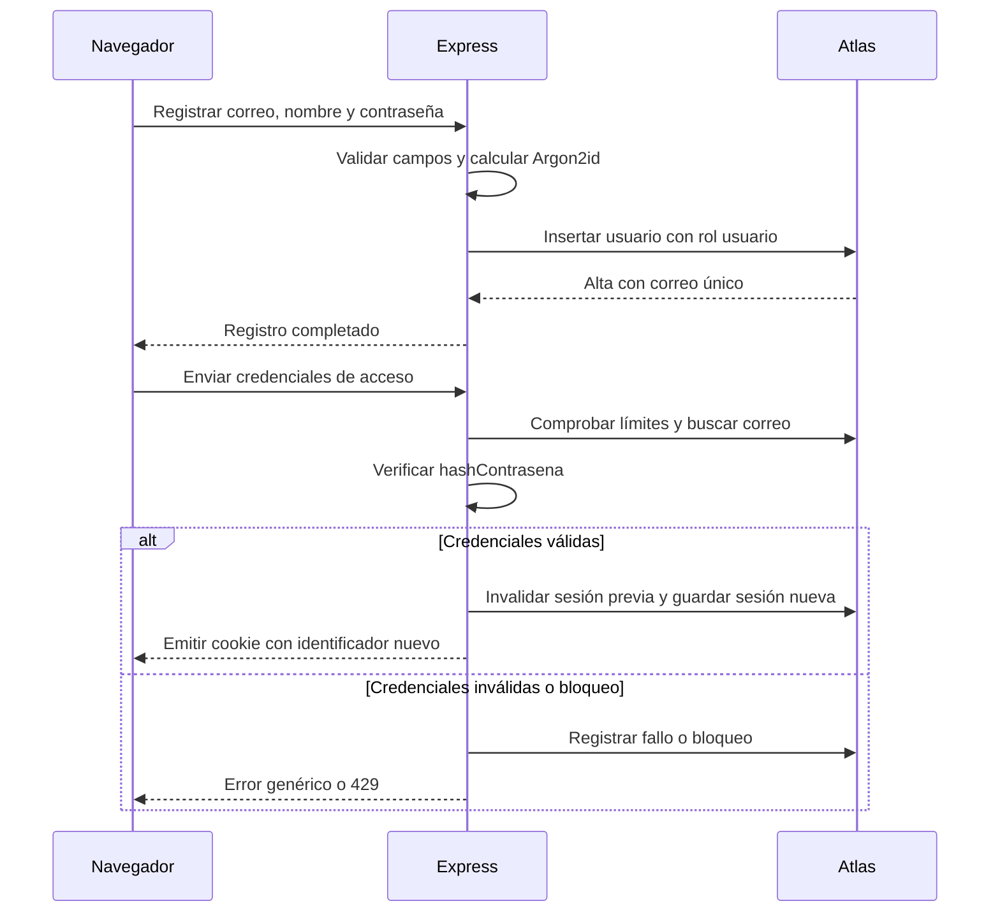
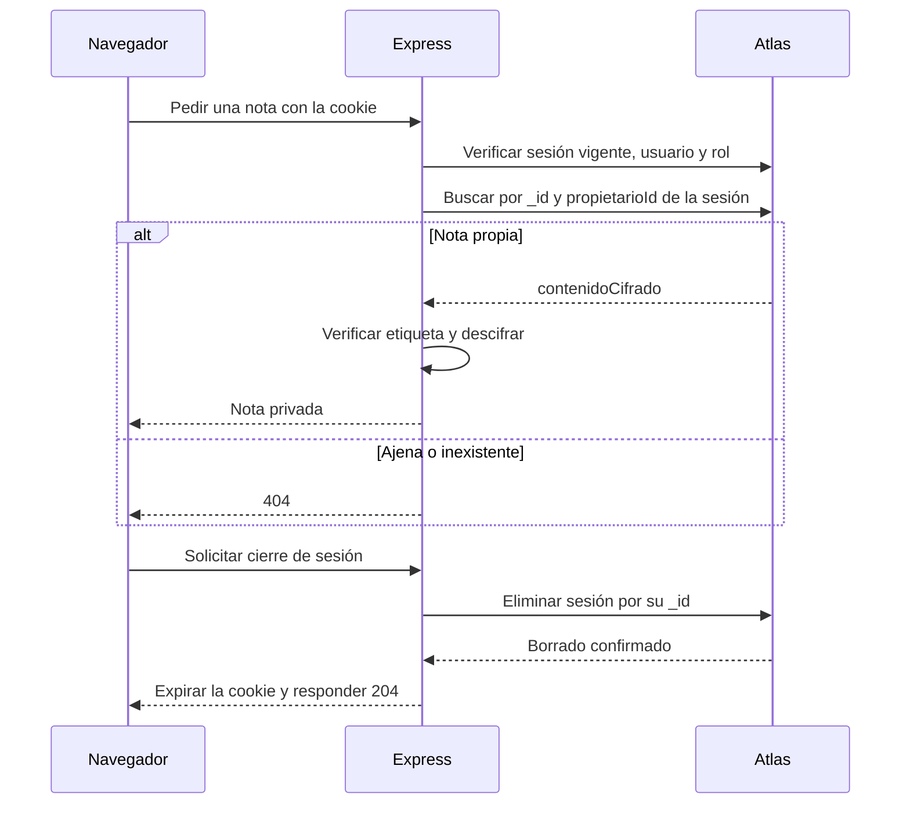

# SecureVault · Diseño de Fase 1

SecureVault guardará notas privadas y un teléfono de perfil. Express atenderá la interfaz y la API en el mismo origen. Render Free alojará el proceso en Virginia y MongoDB Atlas Free mantendrá los datos y las sesiones en el norte de Virginia. El navegador solo se comunicará con Express. El panel docente usará cuentas de prueba y datos ficticios. Este diseño desarrolla los criterios de las secciones 2 a 5 del laboratorio. [Guía](../guialaboratorio.md) · [Decisión de despliegue de Fase 0](./Investigacion_Deploy_SecureVault.pdf)

## 1. Modelo de datos en MongoDB Atlas

El diagrama muestra las relaciones y sus campos de enlace. La recuperación se integra en `usuarios` porque solo puede haber un token vigente por cuenta y su consumo debe coincidir con el cambio de contraseña. Las sesiones se separan para admitir varios dispositivos y cerrar uno en particular. La bitácora tiene su propio acceso y plazo de conservación.

Las referencias son lógicas. Express obtiene el usuario de la sesión y comprueba su existencia en cada petición protegida. `limitesAcceso` también cuenta intentos anónimos, por eso carece de referencia a una cuenta. Todas las fechas usan BSON Date en UTC. Los esquemas validarán tipos y campos permitidos. Cada colección tiene el índice único de MongoDB sobre `_id`.

### Diccionario de campos

| Colección | Campo | Tipo BSON | Obligación y significado |
|---|---|---|---|
| `usuarios` | `_id` | ObjectId | Obligatorio. Identidad interna. |
| | `correo`, `nombre` | string | Obligatorios. Correo de acceso y recuperación, normalizado con recorte y minúsculas. Nombre para mostrar. |
| | `hashContrasena` | string | Obligatorio. Representación PHC de Argon2id con parámetros, sal y hash. |
| | `rol` | string | Obligatorio. Enumeración cerrada a `usuario` y `administrador`. |
| | `versionAcceso` | int | Obligatorio. Empieza en 1. Se incrementa al restablecer la contraseña o cambiar el rol para revocar sesiones anteriores. |
| | `telefonoCifrado` | object | Opcional hasta que el titular guarde su teléfono. Contiene el sobre criptográfico descrito abajo. |
| | `recuperacion` | object | Opcional. Cuando existe, exige `hashToken` (string, SHA-256 hexadecimal) y `expiraEn` (date). Se retira al canjearlo. |
| `notas` | `_id`, `propietarioId` | ObjectId | Obligatorios. Identificador de nota y referencia inmutable a `usuarios._id`. |
| | `posicion` | int | Obligatorio, de 1 a 50. Express asigna este valor interno para aplicar la cuota. |
| | `contenidoCifrado` | object | Obligatorio. Sobre que protege todo el texto de la nota. |
| | `creadaEn`, `actualizadaEn` | date | Obligatorias. Las asigna el servidor. |
| `sesiones` | `_id` | string | Obligatorio. SHA-256 hexadecimal del identificador aleatorio de sesión. |
| | `usuarioId`, `versionAcceso` | ObjectId, int | Obligatorios. Titular y versión leída al verificar su contraseña. |
| | `creadaEn`, `expiraEn` | date | Obligatorias. Vida absoluta propuesta de 8 horas desde el inicio. |
| `eventosSeguridad` | `_id`, `ocurridoEn` | ObjectId, date | Obligatorios. Identificador y hora del evento. |
| | `tipo`, `resultado`, `solicitudId` | string | Obligatorios. Tipo y resultado de catálogo cerrado e identificador opaco generado por Express para correlación. |
| | `actorId`, `objetivoId` | ObjectId | Opcionales. Referencias a `usuarios._id` cuando se conoce al actor o a la cuenta afectada. Un intento anónimo puede omitir ambas. |
| `limitesAcceso` | `_id` | string | Obligatorio. Tipo de operación y HMAC-SHA256 de la IP o correo normalizado, con clave exclusiva. |
| | `intentos`, `inicioVentana`, `expiraEn` | int, date, date | Obligatorios. Contador atómico, inicio de ventana y limpieza posterior. |
| | `bloqueadoHasta` | date | Opcional. Fin de la espera progresiva. La limpieza se programará después de la ventana y del bloqueo. |

| Colección | Índices adicionales y consultas que resuelven |
|---|---|
| `usuarios` | Único en `correo` para registro e inicio de sesión. Único parcial en `recuperacion.hashToken` cuando el campo es string para localizar el token entre cuentas con recuperación. La expiración se comprueba en la escritura. Un TTL sobre el usuario borraría toda la cuenta. |
| `notas` | Único compuesto en `(propietarioId, posicion)` para el cupo. Compuesto en `(propietarioId, actualizadaEn descendente)` para listar las notas propias. Las operaciones por nota usan el índice de `_id` y verifican también `propietarioId`. |
| `sesiones` | Índice en `usuarioId` para limpieza por titular. TTL sobre `expiraEn` con `expireAfterSeconds = 0`. Express comprueba el vencimiento incluso antes del borrado físico. |
| `eventosSeguridad` | Índice en `(ocurridoEn descendente, _id descendente)` para paginar el panel. TTL sobre `ocurridoEn` con retención propuesta de 30 días. |
| `limitesAcceso` | El índice de `_id` permite actualizar el contador. TTL sobre `expiraEn` con `expireAfterSeconds = 0`. Express evalúa la ventana y el bloqueo al recibir la petición. |

MongoDB aplica la unicidad en el índice y ejecuta cada escritura sobre un documento de forma atómica. La limpieza TTL es asíncrona. Estas tres propiedades sustentan la cuota, el canje del token y el vencimiento de las sesiones. [Índices únicos](https://www.mongodb.com/docs/manual/core/index-unique/) · [Atomicidad](https://www.mongodb.com/docs/manual/core/write-operations-atomicity/) · [Índices TTL](https://www.mongodb.com/docs/manual/core/index-ttl/)

### Tratamiento criptográfico y custodia

| Dato | Representación y uso |
|---|---|
| Contraseña | Argon2id con sal aleatoria propia de 16 bytes, memoria de 19 MiB (19 456 KiB), 2 iteraciones y paralelismo 1. En el acceso se verifica el hash PHC. |
| Contenido de nota y teléfono | AES-256-GCM con llave de 32 bytes. El sobre exige `versionLlave` (int), `iv`, `tag` y `datos` (strings Base64). Cada cifrado, incluida cada edición, requiere un nuevo IV aleatorio de 12 bytes. Nunca se reutiliza un par llave/IV. La etiqueta de autenticación ocupa 16 bytes. Se vinculan como datos autenticados la colección, el campo y el identificador inmutable del documento. Express comprueba la etiqueta antes de entregar texto. |
| Teléfono en pantalla | Express valida y normaliza el número antes de cifrarlo. Solo el titular puede actualizarlo y recibe una máscara como `***-***-1234`. La máscara se obtiene al leer el perfil. |
| Recuperación | Token generado con `crypto.randomBytes(32)`, codificado en Base64URL para la entrega. Se guarda únicamente el SHA-256 de los bytes originales y el vencimiento de 15 minutos. |
| Sesión | Identificador opaco e independiente de 32 bytes aleatorios. Cookie firmada con HMAC-SHA256 y `SESSION_SECRET`. Atlas conserva solo el hash del identificador. |

La llave activa `DATA_ENCRYPTION_KEY`, su versión, las versiones anteriores necesarias y `SESSION_SECRET` se suministrarán a Node.js en el panel de secretos de Render. Las credenciales de Atlas, del correo y la llave independiente del limitador tendrán la misma custodia. El repositorio solo contendrá nombres de variables. Se mantendrá un respaldo cifrado de las llaves con acceso restringido y separado de Atlas. Perder todas las copias de una llave hace irrecuperables las notas y teléfonos cifrados con ella. Los hashes de contraseña siguen siendo verificables.

Para rotar la llave se distribuirá primero la nueva versión a todos los procesos y después se activará para escrituras. Cada lectura seleccionará la llave indicada en el sobre. Una tarea de mantenimiento recifrará los registros antiguos por lotes con un IV nuevo. Solo sustituirá el sobre si el valor leído sigue vigente, para preservar ediciones concurrentes. Se verificará que las dos colecciones ya usan la nueva versión y se retendrá la llave anterior mientras existan respaldos que la necesiten.

## 2. Autenticación, sesiones y permisos

### Registro e inicio de sesión

El registro público acepta correo válido, nombre de 1 a 80 caracteres y contraseña de 12 a 128 caracteres con al menos tres grupos entre letras mayúsculas, minúsculas, dígitos y símbolos. Express rechaza campos adicionales, asigna `rol = usuario` y delega la unicidad del correo en Atlas. El alta no inicia sesión. Para el administrador se prevé un aprovisionamiento de mantenimiento con identidad separada y evento de cambio de rol.

El inicio verifica la contraseña con Argon2id y devuelve el mismo `401` ante correo desconocido o contraseña errónea. Para correo desconocido se ejecuta una verificación equivalente con un hash de prueba. Tras autenticar, Express elimina en Atlas la sesión anterior presentada, si existe, y regenera el identificador con el generador criptográfico. Guarda la nueva sesión con la versión de acceso verificada y solo entonces emite la cookie.

La cookie propuesta es `__Host-sid`, con `Secure`, `HttpOnly`, `SameSite=Lax`, `Path=/`, sin `Domain` y con vencimiento de 8 horas. En cada operación protegida, Express verifica la firma, consulta la sesión por su hash, comprueba `expiraEn` y compara `sesiones.versionAcceso` con `usuarios.versionAcceso`. Obtiene el rol actual de ese usuario. Las operaciones que modifican estado exigen origen HTTPS exacto y una cabecera propia de la interfaz, con CORS limitado al mismo origen, para impedir peticiones cruzadas.

### Acceso a notas y cierre de sesión

Para leer, editar y eliminar, **la propia operación en Atlas** llevará el filtro `{ _id: idNota, propietarioId: sesion.usuarioId }`. Se valida antes el formato de `idNota`. Un resultado vacío devuelve el mismo `404` a usuario y administrador. Al crear, Express fija `propietarioId` desde la sesión. Al listar, filtra por ese mismo titular. La petición solo puede aportar el contenido editable.

Al salir, el borrado en Atlas revoca también cualquier copia de esa cookie. Una petición posterior recibe `401`. El cierre repetido puede responder `204` si la sesión ya no existe. Un fallo de Atlas devuelve `503` y no se comunica el cierre como confirmado. Una petición concurrente no puede recrear una sesión borrada mediante una actualización.

### Recuperación de contraseña

| Paso | Decisión de diseño |
|---|---|
| Solicitud | Responder `202` con el mismo mensaje para cualquier correo válido. Si existe la cuenta, reemplazar su objeto `recuperacion`. Solo el último token emitido sigue vigente. Se proponen hasta 3 envíos por correo y 10 por IP en 15 minutos. Se cuentan también las solicitudes a correos desconocidos. |
| Entrega | Enviar el enlace al correo registrado mediante una API de correo por HTTPS. El origen del enlace se fija en configuración. El token viaja en el fragmento de la URL. La página propia lo retira de la barra y lo envía en el cuerpo de la solicitud de canje, sin analítica ni scripts externos. Render Free restringe puertos SMTP salientes. [Documentación de Render](https://render.com/docs/free) |
| Canje atómico | Express calcula el SHA-256 del token recibido, comprueba preliminarmente su vigencia y aplica a la nueva contraseña la política de registro y Argon2id. La decisión final se toma en una única actualización de `usuarios` que exige `recuperacion.hashToken` igual al hash calculado y `recuperacion.expiraEn` posterior al instante de la escritura. Esa escritura reemplaza `hashContrasena`, elimina `recuperacion` e incrementa `versionAcceso`. |
| Resultado | Con un documento modificado, el canje termina y se exige un nuevo inicio de sesión. Con cero, se devuelve `400` genérico por enlace inválido o vencido. Si llegan dos solicitudes simultáneas, la primera elimina el hash y la segunda pierde su coincidencia. Las sesiones anteriores fallan por versión aunque sus documentos sigan presentes. |

### Matriz de permisos y auditoría funcional

| Requisito | Visitante | Usuario autenticado | Administrador autenticado | Estado |
|---|---|---|---|---|
| RF-01 · Registro | Alta pública | Puede usar el alta pública | Puede usar el alta pública | diseñado |
| RF-02 · Sesión | Iniciar con credenciales | Iniciar y cerrar su sesión | Iniciar y cerrar su sesión | diseñado |
| RF-03 · Roles | Solo rutas públicas | Rutas de titular | Rutas de titular y panel de consulta | diseñado |
| RF-04 · Notas privadas | Denegado | Crear, listar, leer, editar y borrar las propias | Las mismas operaciones sobre sus propias notas | diseñado |
| RF-05 · Teléfono de perfil | Denegado | Guardar el propio y consultarlo enmascarado | Igual, solo su perfil | diseñado |
| RF-06 · Recuperación | Solicitar y canjear con token válido | Mismo flujo por el correo de la cuenta | Mismo flujo, también para su cuenta | diseñado |
| RF-07 · Panel | Denegado | Denegado | Consultar lista paginada de usuarios y bitácora | diseñado |
| RF-08 · Salud | Consultar | Consultar | Consultar | diseñado |

El panel proyectará únicamente identificador, nombre, correo y rol de los usuarios, y los campos autorizados de la bitácora. No ofrece edición de roles. Las rutas administrativas devolverán `401` sin sesión y `403` si el rol es insuficiente. `GET /health` será público y devolverá solo un estado genérico, con `200` si está listo o `503` si falla la comprobación acotada de Atlas. Versiones, nombres de servicios y trazas se omiten de la respuesta.

## 3. Límites del negocio

Decisiones propuestas por el equipo para el espacio compartido de Atlas Free. Los límites se comprobarán en Express, también para cuentas administradoras.

| Límite | Cómo se aplica | Respuesta al usuario |
|---|---|---|
| **50 notas por titular** | Para crear, el servidor intenta reservar una de las 50 posiciones al insertar la nota. El validador de Atlas limita `posicion` a enteros de 1 a 50. El índice único impide ocupar dos veces la misma posición para el mismo propietario. Una colisión concurrente hace reintentar con otra posición. Borrar la nota libera el cupo. | Con las 50 posiciones ocupadas, `409 Conflict` y «Alcanzaste el máximo de 50 notas. Podés eliminar una para crear otra». La cuenta conserva acceso de lectura, edición y borrado. |
| **8 KiB por nota** | Al crear o editar se exigen entre 1 y 8192 bytes UTF-8 del contenido, medidos antes del cifrado y de Base64. La interfaz puede anticipar el límite y Express lo impone. El analizador de JSON también limita el cuerpo completo a 64 KiB. | Con 8193 bytes o más, `413 Content Too Large` y «La nota supera 8192 bytes». El contenido anterior se conserva. Un texto vacío recibe `400`. |

## 4. Amenazas y evidencia prevista

La frontera pública termina en el proxy HTTPS de Render. Express aplica autorización, cifrado y reglas de negocio. Atlas confía en la identidad de base de datos del servicio y restringe la red a sus rangos de salida. La siguiente evidencia se producirá con datos ficticios durante la Fase 2.

| STRIDE | Función o dato afectado | Control previsto | Evidencia de Fase 2 |
|---|---|---|---|
| Suplantación | Inicio de sesión con intentos repetidos | Contadores atómicos persistentes. Tras 5 fallos por cuenta en 15 min, espera de 1 min que se duplica con más fallos hasta 15 min. Tope adicional de 30 intentos por IP en 15 min. Emitir alerta al cruzar el umbral. | Prueba de umbral con reloj controlado, respuesta `429` con `Retry-After`, evento de alerta y posterior recuperación del acceso. |
| Manipulación | Reutilización del token o cambio parcial de contraseña | Canje condicionado al hash y al vencimiento en el mismo documento que las credenciales. | Dos canjes concurrentes del mismo token. Un solo éxito, un incremento de versión, una nueva contraseña válida y rechazo de la sesión anterior. |
| Repudio | Accesos al panel y cambios de rol | Registrar hora, actor conocido, objetivo pertinente, resultado y solicitud. Privilegios de inserción para el escritor y lectura separada para el panel. | Trazar un login, una denegación y un cambio de rol de mantenimiento. Comprobar que el escritor no puede editar eventos. |
| Divulgación | Llaves, URI de Atlas, notas y teléfono | Secretos en Render, separación de llaves por uso, TLS y sobres autenticados. Lectura de secretos limitada al personal autorizado. | Inspección del repositorio y de un documento cifrado. Muestra de perfil enmascarado y rechazo controlado si falla la etiqueta. |
| Divulgación | Datos sensibles en eventos o logs | Lista cerrada de campos. Registrar accesos exitosos y fallidos, denegaciones, cambios de rol, canjes y alertas. Excluir cuerpos, cabeceras, URL completas, contraseñas, tokens, cookies, teléfonos y contenido en claro o cifrado. | Comparar una petición con valores ficticios reconocibles contra la bitácora, la salida JSON y el panel. Ningún valor sensible debe aparecer. |
| Denegación de servicio | Almacenamiento de notas y cómputo de autenticación | Cuotas por propietario y por bytes, límite del cuerpo y de intentos antes del trabajo criptográfico costoso. | Probar 8192 y 8193 bytes con texto multibyte. Con 49 notas y dos altas simultáneas, debe haber un éxito, un `409` y 50 notas en total. |
| Elevación de privilegios y divulgación | Acceso a nota ajena o al panel | Comprobar en Express la sesión y el rol actual. Incluir titular e identificador en cada lectura, edición y borrado de nota. El alta pública fija el rol. | Matriz con dos titulares y un administrador. Esperar `404` para notas ajenas de los tres, `403` para el panel de un usuario y éxito para las notas propias. |

### Controles transversales de la sección 3

| OWASP Top 10:2025 | Decisión y evidencia que se preparará |
|---|---|
| A01 · Control de acceso / A06 · Diseño inseguro | Denegación por defecto, filtros de titular, cuotas y pruebas de la tabla STRIDE. El único servicio de correo saliente usará un destino configurado por el equipo. |
| A02 · Configuración / A04 · Criptografía | `NODE_ENV=production`, Helmet con CSP, cabecera `X-Powered-By` desactivada y mismo origen. HTTPS obligatorio con TLS 1.2/1.3. El cliente de Atlas verificará certificado y nombre. En Fase 2 se revisarán cabeceras, flags de cookie, hashes y sobres cifrados. |
| A03 · Cadena de suministro / A08 · Integridad | Dependencias mínimas, archivo de bloqueo versionado y Dependabot. El pipeline planificado ejecutará `npm ci`, pruebas y auditoría de dependencias antes de desplegar el commit aprobado. Los scripts serán locales. Si se incorpora un CDN, se fijarán versión y SRI. Evidencia prevista: configuración de CI y bloqueo ante una verificación fallida. |
| A05 · Inyección | Validar tipos y rechazar campos adicionales antes de construir filtros BSON con campos y operadores fijos. Renderizar la nota como texto escapado. La prueba comprobará el rechazo de tipos inesperados y que el contenido de notas se muestra como texto. |
| A07 · Autenticación / A09 · Registro y alertas | Usar los flujos de sesión y recuperación descritos. Registrar eventos con campos permitidos y disparar una alerta agregada de acceso. Se comprobarán revocación, concurrencia y registros saneados. |
| A10 · Condiciones excepcionales | Fijar tiempos máximos en Atlas y correo. Ante fallo, devolver error genérico con identificador de solicitud, escribir diagnóstico saneado y denegar operaciones protegidas. Ante fallo fatal, cerrar el proceso de forma controlada para que Render lo reinicie. Evidencia prevista: fallo simulado y respuesta sin datos internos. |

### Correspondencia con la plataforma

Render terminará TLS y Express confiará únicamente en el proxy verificado. Se fijará un salto en `trust proxy` solo si la topología y el saneamiento de las cabeceras reenviadas lo justifican. Esto preserva la IP usada por el limitador y el protocolo de la cookie segura. La aplicación mantendrá en Atlas todo estado que deba sobrevivir al reposo de Render.

`MONGODB_URI` corresponderá a una identidad de ejecución con permisos por colección y solo inserción en la bitácora. El panel usará una credencial de lectura separada y restringida, después de autorizar al administrador. La identidad de mantenimiento creará índices, validadores y roles antes de habilitar escrituras. Los rangos de IP de salida publicados por Render son compartidos, por lo que la lista de acceso se combina con TLS y autenticación. El acceso docente, la reactivación de Atlas tras reposo prolongado y la entrega privada de las dos cuentas seguirán el plan de Fase 0.
